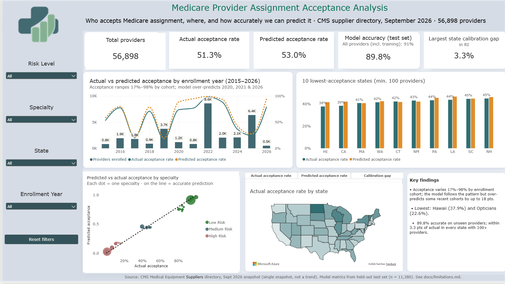
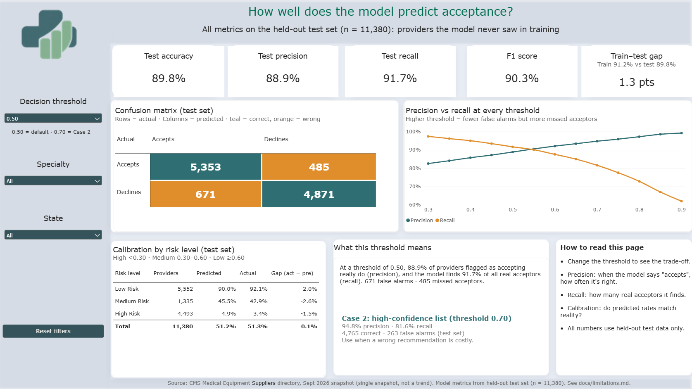

# Medicare Supplier Assignment Acceptance: Analysis & Prediction

**Who accepts Medicare assignment, where, and how accurately can we predict it?**
An end-to-end analytics project on the CMS Medical Equipment Suppliers directory (September 2026, 56,898 suppliers): data-quality review, cleaning, feature engineering, a calibrated classification model, automated tests and a two-page Power BI dashboard.



---

## The problem
Nearly half of Medicare medical-equipment suppliers (**27,707 of 56,898, 48.7%**) do **not** accept Medicare assignment. When a supplier doesn't accept assignment, patients can be charged more than the Medicare-approved amount and pay more out of pocket.

This project answers three questions:
1. **Where and for whom is acceptance low?** (state, provider type, enrollment cohort)
2. **Can we recognise the profile of an accepting supplier?** (classification model)
3. **How should the model be used?** (two business cases with different decision thresholds)

**Audience:** insurers, care-navigation teams, supplier-network managers and researchers.

---

## Key findings
| Finding | Value |
|---|---|
| Overall acceptance | **51.3%** (29,191 accept · 27,707 don't) |
| Lowest state (100+ suppliers) | **Hawaii 37.9%** |
| Lowest / highest provider type (100+ suppliers) | **Opticians 22.6%** · **Optometrists 94.7%** |
| Range by enrollment cohort (2015–2026) | **17% (2019) to 98% (2022)** |
| Model accuracy on unseen suppliers | **89.8%** vs 51.3% baseline |
| Precision at the high-confidence threshold (0.70) | **94.8%** |
| Largest state calibration gap (100+ suppliers) | **3.3 pts** (RI) |

Acceptance is not random: it varies sharply by provider type and enrollment cohort, so outreach should be targeted rather than blanket.

---

## Dashboard (Power BI)
Two pages, built as a **PBIP project** so the report and model are version-controlled as text.

| Page | What it shows |
|---|---|
| **Executive Overview** | KPI cards with dynamic sub-labels, acceptance by enrollment cohort, 10 lowest-acceptance states, predicted vs actual by specialty, state map with a metric switcher (actual / predicted / calibration gap) |
| **Model Performance** | Test-set KPIs, a decision-threshold selector, live confusion matrix, precision-vs-recall curve, calibration by risk band, plain-language summary |



**Techniques used:** DAX measures with display folders and descriptions, a numeric-range threshold parameter driving TP/FP/FN/TN measures, a `SWITCH`-based map metric selector (field parameters can't drive a map's fill colour), Top N ranking limited to states with 100+ suppliers, dynamic text measures, synced slicers, bridge tables for multi-value specialties, a custom colour system (teal = actual, orange = predicted), and alt text on every visual.

---

## Approach
```
Raw CMS extract ─► 01 Data quality ─► 02 Cleaning ─► 03 EDA ─► 04 Features
                                                                  │
   Power BI ◄── 07 Export predictions ◄── 06 Evaluation ◄── 05 Model training
```

| Notebook | Purpose |
|---|---|
| `01_data_quality` | Profile the raw extract (56,898 rows, 17 columns) |
| `02_data_cleaning` | Clean and flag issues; 13 columns kept |
| `03_exploratory_analysis` | Acceptance by state, provider type, cohort |
| `04_feature_engineering` | 165 features; stratified 80/20 split (45,518 train / 11,380 test) |
| `05_model_training` | Compare 6 models, select on generalisation |
| `06_model_evaluation` | Test-set metrics, thresholds, calibration, feature importance, model card |
| `07_powerbi_output` | Score all suppliers and export with the train/test flag |

### Data-quality decision: flag, don't delete
6,811 participation dates fall before 2000; **3,959 are exactly 1998-01-01**. The 10 most common pre-2000 dates (**5,390 rows**) are flagged as suspected placeholders rather than deleted. Deleting them would remove 9% of suppliers and bias the results, because these rows accept less (43.6% vs 52.1%).

---

## Model results
Six models were compared on the same split (`random_state = 42`).

| Model | Accuracy | Precision | Recall | F1 | ROC-AUC | Train–test gap |
|---|---|---|---|---|---|---|
| Random Forest | 0.913 | 0.908 | 0.925 | 0.916 | 0.978 | 0.087 |
| Extra Trees | 0.907 | 0.906 | 0.915 | 0.910 | 0.976 | 0.093 |
| **HistGradientBoosting** ✅ | **0.898** | **0.889** | **0.917** | **0.903** | **0.971** | **0.013** |
| Gradient Boosting | 0.869 | 0.860 | 0.888 | 0.874 | 0.952 | 0.004 |
| Decision Tree | 0.891 | 0.891 | 0.898 | 0.894 | 0.891 | 0.109 |
| Logistic Regression (scaled) | 0.824 | 0.829 | 0.829 | 0.829 | 0.903 | 0.000 |

**Why HistGradientBoosting:** comparable ROC-AUC to Random Forest and Extra Trees (0.971 vs 0.978 / 0.976) with a much smaller train–test gap (0.013 vs 0.087 / 0.093), so better generalisation is expected on new suppliers.

### Held-out test set (n = 11,380)
| Threshold | Precision | Recall | Correct "accepts" (TP) | False alarms (FP) | Missed acceptors (FN) |
|---|---|---|---|---|---|
| 0.50 (default) | 88.9% | 91.7% | 5,353 | 671 | 485 |
| **0.70 (Case 2)** | **94.8%** | **81.6%** | **4,765** | **263** | **1,073** |

- **Accuracy 89.8%** on the test set, against **51.3%** for always guessing "accepts". In-sample accuracy (incl. training rows) is 90.9%; train accuracy is 91.2%. The small gap shows no overfitting.
- **Calibration by risk band** (test set): Low +2.0 pts · Medium −2.6 pts · High −1.5 pts · overall +0.1 pts. Predicted probabilities can be used directly for ranking.

### What drives the predictions
`tenure_days` ranks first in permutation importance, but the relationship is **not** "longer tenure means higher acceptance" (Spearman ρ = −0.08). Acceptance is about 96% for suppliers enrolled roughly late 2020 to early 2023 and about 39–46% otherwise: a **cohort effect**, reported as a hypothesis, not a cause.

---

## Business cases
Full details: [`docs/business_cases.md`](docs/business_cases.md). Dollar values are labelled assumptions.

1. **Raise acceptance where it's lowest:** target the 27,707 non-accepting suppliers, starting with the lowest-acceptance states and provider types.
2. **Convert suppliers who look like acceptors:** at the 0.70 threshold, 263 test-set suppliers are predicted to accept but don't (about 1,315 directory-wide). They resemble acceptors, so they are the most likely to convert.

**Why predict a status the directory already contains?** The label shows who accepts *today*. The model shows who *resembles* an acceptor: it can score new suppliers before their status is known and surface non-acceptors with an acceptor's profile. The value is in the ranking and the gaps, not the prediction itself.

---

## Limitations
Full list: [`docs/limitations.md`](docs/limitations.md).
- **Single snapshot (September 2026):** no trends or time forecasts. Enrollment year describes cohorts, not a timeline.
- **Association, not causation:** the model can't say *why* a supplier declines.
- **Cohort calibration:** the model over-predicts the 2020 (+15 pts), 2021 (+18 pts) and 2026 (+16 pts) enrollment cohorts.
- **Directory data:** reflects what suppliers state, not actual billing behaviour.
- The July 2026 extract had 57,197 rows; the 299-row difference is reconciled in [`docs/row_reconciliation.md`](docs/row_reconciliation.md).

---

## Quality checks
`tests/test_outputs.py` runs **8 automated checks** on the pipeline output: row count, unique provider IDs, no missing key fields, probabilities between 0 and 1, train/test split sizes, binary labels, the 51.3% acceptance rate and the 89.8% test accuracy. Key dashboard numbers were also reconciled with the notebooks (for example, the confusion-matrix counts match exactly).

---

## How to run
**Requirements:** Python 3.12, Power BI Desktop (for the dashboard).

```bash
git clone https://github.com/genet-sql-bi/cms-supplier-acceptance-analysis.git
cd cms-supplier-acceptance-analysis
python -m venv venv
venv\Scripts\activate            # Windows  (macOS/Linux: source venv/bin/activate)
python -m pip install -r requirements.txt
```
1. Download the **CMS Medical Equipment Suppliers** dataset (September 2026 extract) and save it as `data/raw/Medical-Equipment-Suppliers_2026-09.csv`. Raw data is not committed.
2. Run notebooks `01` → `07` in order.
3. Run the tests: `python -m pytest -v`
4. Open `powerbi/MedicalProviderAcceptanceDashboard.pbip` in Power BI Desktop and refresh.

---

## Repository structure
```
├── data/            raw / interim / processed (git-ignored)
├── docs/            business cases, limitations, row reconciliation
├── models/          trained model and model card
├── notebooks/       01–07 pipeline
├── powerbi/         PBIP report and semantic model
├── reports/         figures and validation outputs
├── src/             supporting code
├── tests/           automated data-quality checks
├── requirements.txt
└── LICENSE          MIT
```

---

## Next steps (v2)
- Re-run on future CMS extracts to measure real trends.
- Add a SQL layer for the data model.
- Test enrollment-year features to reduce the cohort over-prediction.
- Cross-validated hyperparameter tuning.

---

**Author:** Genet Tesfamichael · [GitHub](https://github.com/genet-sql-bi)

**License:** MIT